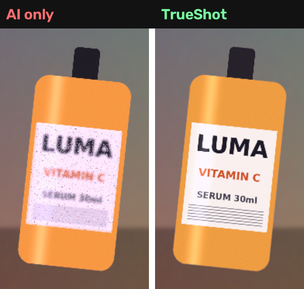

# TrueShot — AI product photos where your label never melts

**An open-source, open-weights product photo studio for ComfyUI.** Entry for Comfy's `#OpenSourceHiggsfield` challenge.

One phone photo of your product goes in. A full commerce shot pack comes out: a white-background marketplace photo, lifestyle scenes from a one-line brief, a 9:16 story and a 16:9 banner. In every shot the product is **the real product, pixel for pixel**.



## The problem

Image models are great at scenes and bad at *your* product. Labels turn into gibberish, logos warp, a 30 ml bottle becomes a 50 ml one. For a small seller that makes the image useless, because the photo has to show the product that ships. Higgsfield-style marketing studios generate the whole frame and hope.

## How TrueShot works

```
phone photo ─▶ Cutout ─▶ Plan shot pack ─▶ FLUX.2 Klein reference edit (per shot, per variant)
                 │             │                          │
                 │             └─ staged reference: real product placed where it should sit in each format
                 ▼                                        ▼
            Marketplace (white bg,                Pixel-True Restore ─▶ shots + before/after cards + fidelity report
            100% real pixels)                     locate → align → harmonise → seam → QC → keep best variant
```

1. **Cutout.** IS-Net (rembg) matte when available, with a GrabCut fallback seeded from a Lab colour model of the photo border. Largest component, holes filled, feathered edge.
2. **Plan.** Every format (lifestyle 1:1, story 9:16, banner 16:9, close-up) has a layout: product height, horizontal position and base line. The real product is **staged** on a neutral card at exactly that spot, and that staged image is the generator's reference. The generator is told to keep the product exactly where it is, so the scene gets built around it.
3. **Generate.** FLUX.2 Klein 4B reference editing (open weights), one run per shot and per variant, through ComfyUI list mapping.
4. **Pixel-true restore**, the part generators can't do on their own:
   - **Locate.** SIFT features on the real product (inside its matte) are matched against the render, with a ratio test and a MAGSAC++ homography, rejected unless it's convex, sane in area and sane in aspect. Then it's refit as a similarity transform unless the full perspective clearly explains the matches better. If there aren't enough features, it falls back to multi-scale masked template matching, then to the staged layout prior.
   - **Align and paste.** The *original* pixels are warped onto the render.
   - **Harmonise.** Partial Lab mean/contrast transfer from what the model rendered as the product, so the real product takes on the scene's light and colour cast while keeping every letter of its label.
   - **Seam.** A feathered matte edge, so the generated rim, shadow and reflections stay and blend.
   - **QC.** Label fidelity is measured as masked SSIM against the real product, before and after restore. With several variants, it keeps the one where the generator stayed most faithful, so the seams are cleanest.
5. **Marketplace shot.** Deterministic and with no generation at all: real product, white background, soft contact shadow.

Every run writes `shot_*`, `compare_*` (AI only vs TrueShot zoom), `ai_only_*`, `marketplace_*`, `sheet_*` and a text report such as:

```
5/5 shots restored | label fidelity (SSIM vs real product) 0.68 -> 0.99
```

## Nodes

| Node | In → Out |
|---|---|
| `TrueShot · Cutout Product` | IMAGE → product crop, MASK, preview |
| `TrueShot · Marketplace (white bg)` | product + matte → listing photo |
| `TrueShot · Plan Shot Pack` | product, matte, name, brief, formats, variants → plan + **lists** of staged refs, prompts, widths, heights, seeds |
| `TrueShot · Pixel-True Restore` | plan + product + matte + generated list → restored shots, comparison cards, best AI-only shots, report |
| `TrueShot · Contact Sheet` | image list → one sheet |

Plan Shot Pack's list outputs work with any reference-capable image model, not just Klein.

## Run it free on Kaggle

New notebook → Settings: **GPU T4 x2**, **Internet on**. Paste this into one cell and run it:

```python
IMAGE_URL = ""   # direct link to your product photo; empty = demo product
PRODUCT   = "a bottle of LUMA vitamin C serum"
BRIEF     = "on a marble bathroom counter with eucalyptus | on wet black stones with water splashes | on a sunlit beach towel next to sunglasses"
FORMATS   = "lifestyle,lifestyle,lifestyle,story,banner"
VARIANTS  = 1
import urllib.request, time
src = urllib.request.urlopen(f"https://raw.githubusercontent.com/nedsoft057/ComfyUI-TrueShot/main/kaggle/trueshot_kaggle.py?t={time.time()}").read().decode()
exec(src.split("# -------------------------------------------------------------------------", 1)[1])
```

It installs ComfyUI and this pack, downloads FLUX.2 Klein 4B, the Qwen3-4B text encoder and the FLUX.2 VAE (all open weights), starts ComfyUI headless, renders the pack and copies everything to `/kaggle/working/TrueShot/`.

## Run it on your ComfyUI

```bash
cd ComfyUI/custom_nodes && git clone https://github.com/nedsoft057/ComfyUI-TrueShot
pip install -r ComfyUI-TrueShot/requirements.txt rembg onnxruntime   # rembg optional
python ComfyUI-TrueShot/scripts/run_trueshot.py --comfy-dir .. --image my_product.jpg \
  --product "a can of Zobo hibiscus drink" --brief "on a market stall in Lagos|in an ice bucket at a party"
```

The API-format graph is in [`workflows/trueshot_api.json`](workflows/trueshot_api.json).

## Tests (CPU, no GPU needed)

```bash
python tests/test_core.py   # matte IoU, then restore on simulated AI renders that garble the label (rotation, scale, colour cast)
```

## License

Apache-2.0. Model weights are under their own licenses.
