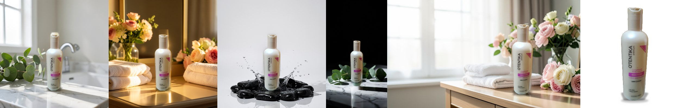
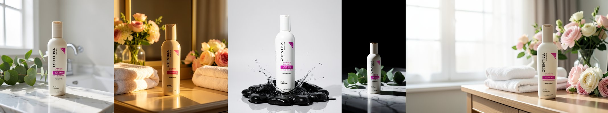

# TrueShot

### Your product. Better presented. Never misrepresented.

**An open-source, open-weights product photo studio for ComfyUI.** One phone photo of a real product goes in. A shop-ready shot pack comes out, and every image carries a **Product Truth Score** that proves the product in it is still *your* product.

Entry for Comfy's `#OpenSourceHiggsfield` challenge. Higgsfield-style marketing studios generate the whole frame and hope. TrueShot generates the scene and **keeps the product real**.


*Real outputs from one run on a free Kaggle T4, made from a single phone photo ([examples/otentika_phone_photo.jpg](examples/otentika_phone_photo.jpg)). Left of each pair: FLUX.2 Klein on its own (the O'TENTIKA / MAXITONE label turns to gibberish). Right: TrueShot.*

**Demo video:** [media/TrueShot_demo.mp4](media/TrueShot_demo.mp4)

**TrueShot shot pack:**



**Same prompts, AI-only (no lock):**



---

## Who it's for

Most small sellers don't want "AI images". They need to **list a product today, launch a promo, update a catalogue, look trustworthy**, and they can't book a photoshoot every time new stock lands.

| Who | The pain | What TrueShot gives them |
|---|---|---|
| **Instagram & WhatsApp vendors** | 15 new items arrive, photographed in a bedroom: bad light, messy background, nothing matches | A consistent catalogue look, lifestyle scenes, story and post formats, with the real item in every one |
| **Small brands launching a product** | A real serum, a real bottle and no budget for a campaign shoot | Hero shots, banners and announcement creatives in one pass, in a consistent direction |
| **Catalogue managers & dropshippers** | 100+ SKUs from 20 suppliers, every photo different | The same framing, background and export sizes every time, plus a marketplace compliance check before upload |
| **Second-hand sellers** | Cluttered photos, and buyers who need to see the real condition | Clean listings that **keep every scratch and dent**, because the product pixels are never regenerated |
| **Small agencies** | Five clients, the same production grind every week | A repeatable ComfyUI graph and a headless runner they can batch |

## Why AI-only product photos fail

Image models are great at scenes and unreliable with *your* product. Labels turn into gibberish, logos warp, a 30 ml bottle becomes a 50 ml one, colours drift and caps change shape. For a seller that image is worse than useless: it's a **misrepresentation of what ships**.

TrueShot treats the product as ground truth and everything else as generative.

---

## What one run produces

| Output | What it is |
|---|---|
| `marketplace_*` | A white-background main image built from **100% real product pixels** (no generation), with an **Amazon-style compliance check**: pure white background, ≥1000 px, product fills ≥85% of the frame, not cropped |
| `shot_*` | Lifestyle 1:1, story 9:16 and banner 16:9 (text space left), plus optional close-ups. Scene generated, product restored |
| `compare_*` | A zoomed **AI-only vs TrueShot** card for each shot, with both Truth Scores |
| `ai_only_*` | What the model produced on its own, kept for honesty |
| `sheet_*` | A contact sheet of the pack |
| report | Per-shot **PASS / REVIEW** verdict and score breakdown |

```
5/5 shots restored | label fidelity (SSIM vs real product) 0.94 -> 0.99
shot 0 (lifestyle) v0: PASS | truth AI-only 80 -> TrueShot 98 [label 69->99, shape 98->99, colour 82->95] geometry verified (locked)
shot 1 (lifestyle) v0: PASS | truth AI-only 64 -> TrueShot 97 [label 55->99, shape 77->98, colour 68->90] geometry verified (locked)
shot 2 (lifestyle) v0: PASS | truth AI-only 74 -> TrueShot 95 [label 68->99, shape 82->88, colour 75->94] geometry verified (locked)
shot 3 (story)     v0: PASS | truth AI-only 55 -> TrueShot 98 [label 48->99, shape 48->98, colour 85->93] geometry verified (locked)
shot 4 (banner)    v0: PASS | truth AI-only 51 -> TrueShot 98 [label 53->99, shape 48->99, colour 53->96] geometry verified (locked)
marketplace main image: PASS | white bg True | >=1000px True | product fill 89% (>=85%: True) | not cropped True | product pixels: 100% real
```

## Product Truth Score

Other tools compete on how pretty the image is. TrueShot also measures **how faithfully it shows the real product**, and won't pass a shot it can't verify.

| Component | How it's measured |
|---|---|
| **Label** | Masked SSIM between the shot's product region and the real product, aligned. This is where text, logos and fine print live |
| **Shape** | IoU between the silhouette the image actually shows (re-segmented from the output) and the real silhouette |
| **Colour** | Lab a*b* chroma distance, so it ignores lighting and catches a red cap that turned orange |
| **Geometry** | `verified` only when feature matching found the product with enough consistent inliers |

`total = 0.5·label + 0.3·shape + 0.2·colour`. A shot is **PASS** only when the geometry is verified and the total is at least 85. Otherwise it's **REVIEW**: TrueShot says when it can't guarantee preservation (heavy occlusion, a new viewing angle) instead of quietly shipping a wrong product.

---

## How it works

```
phone photo ─▶ Cutout ─▶ Plan shot pack ─┬─▶ LOCKED: staged latent + regen mask ─▶ FLUX.2 Klein masked sampling
                 │                         │      (product latent held fixed, only the scene is generated)
                 │                         └─▶ BASELINE: plain Klein reference edit (AI-only, for comparison)
                 ▼                                              ▼
           Marketplace                          Pixel-True Restore (exact geometry)
           (real pixels, compliance)            ghost removal ─▶ paste real pixels ─▶ contact shadow ─▶ seam
                                                ─▶ Truth Score: AI-only vs TrueShot ─▶ PASS / REVIEW
```

1. **Cutout.** An IS-Net matte via `rembg` when available, falling back to GrabCut seeded from a Lab k-means model of the photo border. It keeps the largest component, fills holes (labels, reflections) and feathers the edge.
2. **Plan + stage.** Each format has a layout (product height, centre, base line). The real product is staged at that exact spot on a neutral card, and that becomes the generator's reference, so the model builds the scene *around* the product instead of reinventing it.
3. **Generate, locked.** The staged image is VAE-encoded and given a **regen mask** (everything except the product, slightly grown), and FLUX.2 Klein 4B samples with that noise mask. The product latent is held fixed at every step, so the model paints the scene *around the real product* and its geometry is known exactly. A plain unmasked Klein edit runs alongside as the **AI-only baseline** for the comparison and the AI-only Truth Score.
4. **Locate (free mode / baseline).** SIFT on the real product (inside its matte) against the render, then a ratio test, then a MAGSAC++ homography. It's rejected unless the quad is convex and the area and aspect are sane, and it's refit as a similarity transform unless the full perspective clearly explains more matches. Fallbacks are multi-scale masked template matching, then the staged layout prior.
5. **Ghost removal.** Where the model drew *more* product than exists (a wider bottle, a phantom cap, a second bottle sketched behind the locked one), it re-segments the render and inpaints the scene back in.
6. **Harmonise.** Partial Lab mean and contrast transfer from what the model rendered *as the product*, so the real product takes the scene's light and colour cast while every letter of the label stays intact.
7. **Paste + seam + shadow.** The real pixels go in at the exact staged transform with a feathered matte edge, plus a soft contact shadow derived from the silhouette.
8. **Score + select.** Truth Score for the AI-only and TrueShot versions. With several variants per shot, it keeps the one where the generator stayed most faithful, which gives the cleanest seams.

All of TrueShot's own logic is numpy and OpenCV. It runs on CPU and is unit-tested without a GPU.

## Nodes

| Node | In → Out |
|---|---|
| `TrueShot · Cutout Product` | IMAGE → product crop, MASK, preview |
| `TrueShot · Marketplace (white bg)` | product + matte → listing image, compliance report |
| `TrueShot · Plan Shot Pack` | product, matte, name, brief, formats, variants → plan + **lists** of staged refs, prompts, widths, heights, seeds |
| `TrueShot · Pixel-True Restore` | plan + product + matte + generated list → restored shots, comparison cards, AI-only shots, report |
| `TrueShot · Contact Sheet` | image list → one sheet |

Plan Shot Pack's lists plug into any reference-capable image model. Klein is the open-weights default.

---

## Run it free on Kaggle (one cell, phone-friendly)

New notebook → **Session options**: Accelerator **GPU T4 x2**, Internet **On**. Paste this into one cell:

```python
IMAGE_URL = ""   # direct link to your product photo; empty = built-in demo product
PRODUCT   = "a bottle of LUMA vitamin C serum"
BRIEF     = "on a marble bathroom counter with eucalyptus | on wet black stones with water splashes | on a sunlit beach towel next to sunglasses"
FORMATS   = "lifestyle,lifestyle,lifestyle,story,banner"
VARIANTS  = 1
import urllib.request, time
src = urllib.request.urlopen(f"https://raw.githubusercontent.com/nedsoft057/ComfyUI-TrueShot/main/kaggle/trueshot_kaggle.py?t={time.time()}").read().decode()
exec(src.split("# -------------------------------------------------------------------------", 1)[1])
```

It installs ComfyUI and this pack, downloads FLUX.2 Klein 4B (fp8), the Qwen3-4B text encoder and the FLUX.2 VAE (all open weights), starts ComfyUI headless and writes the pack to `/kaggle/working/TrueShot/`.

## Run it on your own ComfyUI

```bash
cd ComfyUI/custom_nodes && git clone https://github.com/nedsoft057/ComfyUI-TrueShot
pip install -r ComfyUI-TrueShot/requirements.txt rembg onnxruntime   # rembg optional
python ComfyUI-TrueShot/scripts/run_trueshot.py --comfy-dir .. --image my_product.jpg \
  --product "a can of hibiscus zobo drink" \
  --brief "on a busy Lagos market stall|in an ice bucket at a rooftop party|on a picnic mat in the park"
```

The API-format graph is in [`workflows/trueshot_api.json`](workflows/trueshot_api.json).

## Tests (CPU only)

```bash
python tests/test_core.py
```

It builds a synthetic labelled product and a "phone photo", checks matte IoU, then simulates AI renders that garble the label (scale, rotation, colour cast) and asserts that the restored label fidelity rises above the AI-only one.

## Honest limits

- Pixel restoration needs the product to be **visible from roughly the same angle** as the source photo. New viewpoints, heavy occlusion or a hand wrapped around the product get **REVIEW**, not a fake PASS.
- Harmonisation shifts global tone only. It doesn't relight specular highlights.
- Not covered yet: virtual try-on for garments, and video.

## License

Apache-2.0. Model weights are under their own licenses.
